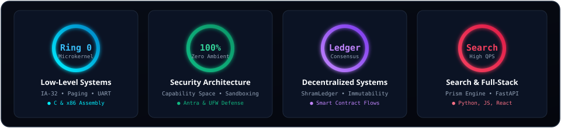
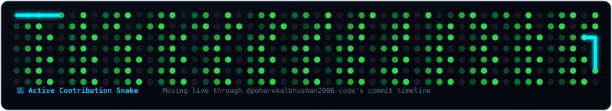

<!-- ========================================================================== -->
<!-- 🚀 KULBHUSHAN POHARE - PUBLIC GITHUB PROFILE & OBSERVABILITY DASHBOARD       -->
<!-- ========================================================================== -->

<!-- Custom Cyberpunk Animated Hero Banner -->

  

<!-- Animated Dynamic Typing Tagline -->

 

<!-- Visitor Counter & Quick Contact Badges -->

  
  
  
  

---

## ⚡ Engineering Competencies & Architectural Radar

  

---

## 📊 Live GitHub Telemetry & Activity Metrics

<!-- GitHub Stats & Streak Stats Grid -->
<table>
  <tr>
    <td width="50%" align="center">
      
    </td>
    <td width="50%" align="center">
      
    </td>
  </tr>
  <tr>
    <td width="50%" align="center">
      
    </td>
    <td width="50%" align="center">
      
    </td>
  </tr>
</table>

<!-- Trophy Showcase -->
 

---

## 🐍 Animated Contribution Snake

Every commit feeds the snake crawling across my GitHub contribution matrix:

  

---

## 🚀 Flagship Projects & Repositories

| Project | Domain | Architecture & Highlights | Repository |
| :--- | :--- | :--- | :--- |
| **🛡️ Nexus OS** | Operating Systems &amp; Microkernels | Bare-metal IA-32 microkernel with **Zero Ambient Authority**, 2-level paging (CR3/CR0), 4KB frame bitmap allocator, UART 16550 serial streaming, and a **Mica Web Observability Cockpit**. | `Nexus-OS` |
| **⛓️ ShramLedger** | FinTech &amp; Distributed Ledger | Decentralized contractor, wage transparency, and credit platform powered by immutable distributed records and smart transaction verification. | [`shramledger`](https://github.com/poharekulbhushan2006-code/shramledger) |
| **🔍 Prism Search Engine** | Information Retrieval &amp; Systems | High-performance search platform featuring index acceleration, lexical ranking algorithms, and low-latency query resolution. | [`prism-search-engine`](https://github.com/poharekulbhushan2006-code/prism-search-engine) |
| **🔐 Antra Security System** | Cybersecurity &amp; Defense | Automated intrusion detection, network packet inspection, host defense, and rule-based system hardening. | [`antra-security-system`](https://github.com/poharekulbhushan2006-code/antra-security-system) |
| **📝 Eureka Blog** | Full-Stack Web Platform | Modern engineering blog engine featuring markdown compilation, authenticated author workflows, and responsive typography. | [`eureka-blog`](https://github.com/poharekulbhushan2006-code/eureka-blog) |
| **🛡️ OIBSIP Security Suite** | Network &amp; Host Hardening | Custom UFW firewall automation, port filtering, and security posture auditing. | [`OIBSIP`](https://github.com/poharekulbhushan2006-code/OIBSIP) |

---

## 🛠️ Languages, Toolchains & Frameworks

### Systems &amp; Low-Level

  
  
  
  
  
  

### High-Level Languages &amp; Backend

  
  
  
  
  
  

### Frontend &amp; Observability

  
  
  
  
  

### DevOps, Security &amp; Tools

  
  
  
  
  

---

## 💬 Get In Touch

  I am always open to collaborating on <b>Operating System kernels</b>, <b>compiler toolchains</b>, <b>decentralized infrastructure</b>, and <b>cybersecurity tools</b>. 
  Feel free to reach out or connect!

  
  

 

  ⚡ Designed with animated SVGs &amp; live telemetry for GitHub. Engineered by <b>Kulbhushan Kailas Pohare</b>.

